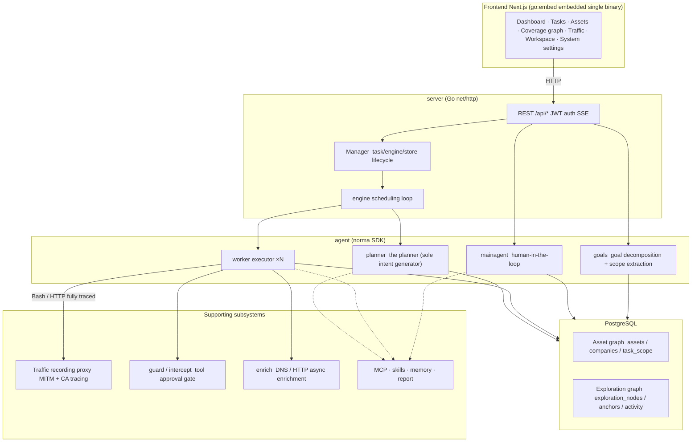
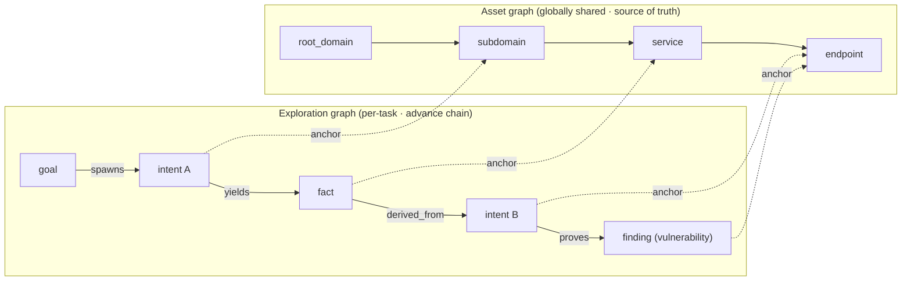
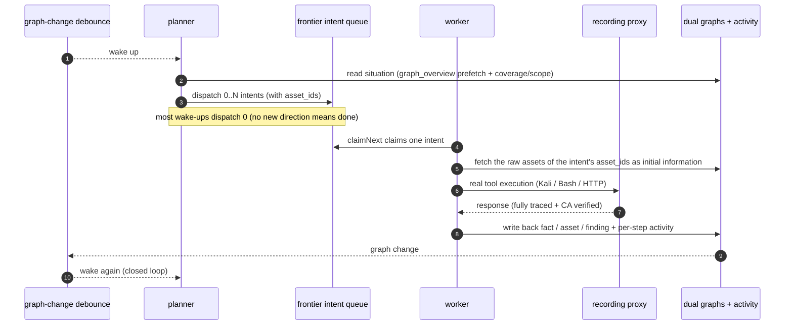
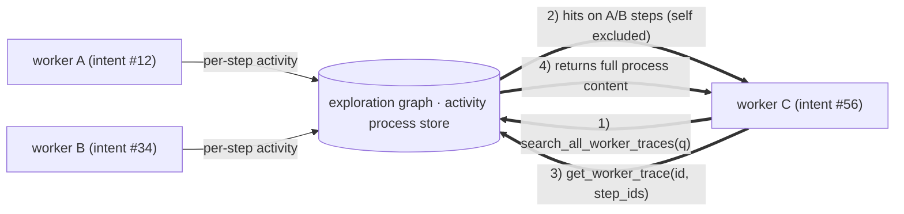
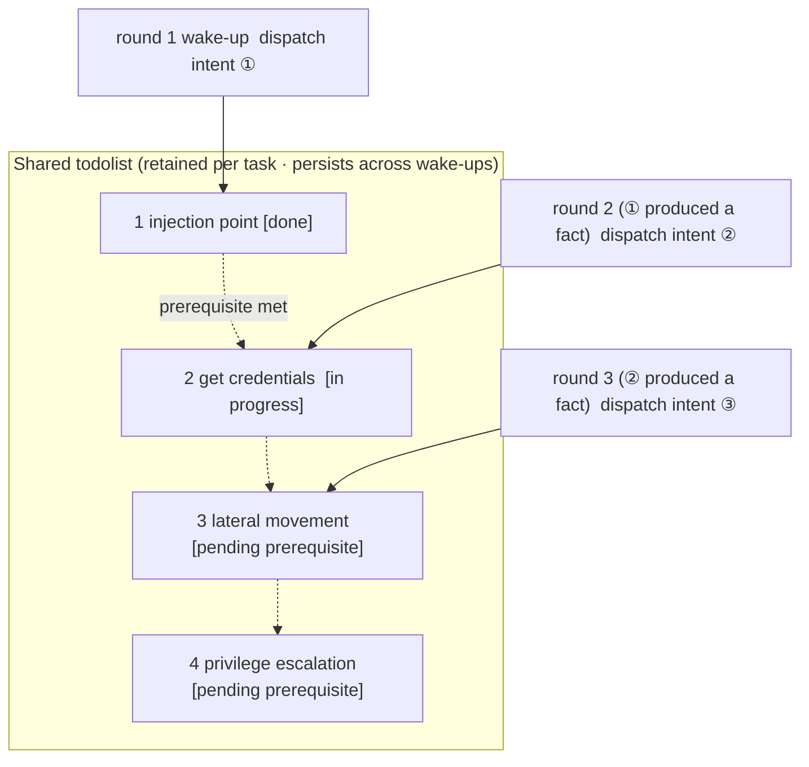

<div align="center">

# ARTEX

AI autonomous penetration testing & internal lateral-defense platform (Go backend + Next.js frontend)

English · [中文 README](README_zh.md) · [中文使用手册](docs/USER_MANUAL_zh.md)

 Fork of [ARTEX by Autumn-27](https://github.com/Autumn-27) · maintained independently with enterprise intranet, MLPS 2.0, OOB/PoC, and bilingual (`zh-CN`/`en`) capabilities under AGPL-3.0

</div>

---

## Screenshots


| Dashboard (overview / token usage / activity stream) | Task list |
| :---: | :---: |
|  |  |

| Task · execution (sessions / tool calls) | Exploration graph |
| :---: | :---: |
|  |  |

| Findings | Assets |
| :---: | :---: |
|  |  |

| Asset coverage graph (force-directed layout · tested highlights · node collapse/expand) |
| :---: |
|  |

| Traffic recording | Human-in-the-loop chat |
| :---: | :---: |
|  |  |

| Agent management | LLM configuration |
| :---: | :---: |
|  |  |

| Interception approvals | Backend logs |
| :---: | :---: |
|  |  |


---

## Approval record details

The global "Approval Records", the in-task "Interception Approvals", and the approval cards in conversations all support expanding to view details. The display structure references the
[AegisHook approval details component](https://github.com/RuoJi6/AegisHook/blob/main/web/src/components/CallDetail.vue), reusing ARTEX's components and theme:


## Traffic capture browser extension

The bundled browser extension (`extension/`) turns your own browsing into agent-visible evidence: log into an authenticated target once (captchas, email OTP and 2FA included), and the captured requests/responses land in ARTEX's traffic store like proxy-recorded traffic, ready to search and bind to findings:

- Load the unpacked extension from `extension/` (Chrome/Edge, Developer Mode → Load unpacked);
- In the popup, set your ARTEX URL and token, then press **Start capture** on the tab you are browsing;
- Use the site normally; text requests/responses are batched to `POST /api/traffic/ingest` (authenticated). Binary bodies (images, fonts) are skipped, bodies are truncated at 256 KiB, batches are capped at 50 entries;
- Press **Stop** when done. Everything stays in your local traffic store.

## Asset sync (ScopeSentry)

Sync asset data directly from [ScopeSentry](https://github.com/Autumn-27/ScopeSentry), avoiding duplicate collection:

- On the "**Asset Sync**" page, enter the ScopeSentry address and API Key to connect the data source;
- Choose the targets and asset types to sync by **project** or **task** (domains / subdomains / IPs / ports / sites / endpoints…);
- One-click import, merged by company asset scope, straight into ARTEX's asset graph for agents to explore.

---

## Installation

> Requires a **PostgreSQL** database; exploration requires an **LLM** (`ANTHROPIC_API_KEY` or `OPENAI_API_KEY`, which can also be configured in the UI).

### Option 1: one-click install script (recommended)

```bash
git clone https://github.com/zealot00/ARTEX.git
cd ARTEX
./install.sh
```

The script will: detect / auto-install Docker → then let you choose **① all-Docker** or **② local build and run**:

- **① All-Docker**: enter a Postgres password (press Enter for a random one) → auto-writes `.env` → `docker compose up -d --build` (the image is built from this checkout).
- **② Local run**: choose a database (connect to an existing one / start one with Docker) → generates `config.json` → `go` builds the embedded single binary → starts.

Once installed, open **http://localhost:8787**. **There is no default password**: on first visit, `/setup` asks for a one-time setup token printed in the backend startup log (`docker compose logs artex | grep "Setup token"`, or the terminal running `./start.sh`) so you can set your own admin password (minimum 12 characters, max 72 bytes).

- **Web UI Login Username**: fixed as uppercase **`ARTEX`** (case-sensitive, not `admin`).
- **Web UI Login Password**: the password you initialize on `/setup`.

The web UI is published on `127.0.0.1` by default. To reach it from another machine, or from Windows when ARTEX runs inside WSL, set `ARTEX_BIND_ADDR=0.0.0.0` in `.env` (the setup token still protects the first-run claim), or keep loopback and use a reverse proxy or an SSH tunnel.

### Option 2: Docker Compose (manual)

```bash
git clone https://github.com/zealot00/ARTEX.git
cd ARTEX
cp .env.example .env          # set POSTGRES_PASSWORD, optionally ANTHROPIC_API_KEY
docker compose up -d --build  # builds artex from this checkout + starts postgres
# → http://localhost:8787
```

> The image is built locally. There is no published image to pull: the previous
> default pointed at a third-party namespace that no longer hosts this project.

The image already includes common recon, exploitation, AD/lateral, and static-audit tools (`nuclei` + offline `/opt/nuclei-templates`, `semgrep`, `impacket`, `netexec`, `bloodhound-python`, `certipy`, `chisel`, `kubectl`, `sqlmap`, `ffuf`, `httpx`, `subfinder`, `katana`, `dalfox`, `bbot`, `hydra`, `nmap`…); `./data`, `./keys` (including `jwt.key` and the AES-256-GCM encrypted wordlist vault), `./skills`, and `./pocs` (75+ hot-loaded infrastructure/intranet PoCs) are persisted via bind mounts.

For remote MCP, you can choose `http` (Streamable HTTP) or `sse` (legacy SSE) in system settings.
Legacy SSE servers usually establish the event stream with `GET /sse`, then receive JSON-RPC requests via the
`/message?sessionId=...` returned by the server; when configuring, set the URL to `/sse` and the request header as
`Authorization=Bearer <token>`.

### Option 3: download prebuilt binaries (Releases)

Download the zip for your platform from [Releases](https://github.com/zealot00/ARTEX/releases); after extracting you get `artex` + `start.sh` (`start.bat` on Windows) + `skills/` + `pocs/` + `config.example.json`:

```bash
cp config.example.json config.json   # fill in the database connection
./start.sh                           # → http://localhost:8787
```

> Please start with `start.sh` / `start.bat` instead of running `./artex` directly. It is a daemon script: if the process crashes, it restarts it after a backoff.
> To keep it running in the background: `nohup ./start.sh >artex.log 2>&1 &`.

### Option 4: build the single binary from source

```bash
# 1) frontend static export
cd web && npm ci && npm run build:static && cd ..
# 2) copy into the embed directory
cp -r web/out server/webui/dist
# 3) build (only -tags embedui embeds the frontend)
CGO_ENABLED=0 go build -tags embedui -o artex ./cmd/artex
./start.sh
```

### Option 5: build cross-platform release archives

`build.sh` first builds and embeds the frontend, then strips debug info via the Go linker, and compresses the release files into zips. Release mode generates zips for Linux amd64/arm64, macOS amd64/arm64, and Windows amd64 by default:

```bash
./build.sh --release
# output: dist/artex-0.3.3-*.zip
```

UPX self-extracting binaries may be incompatible with some Linux kernels, virtualization environments, or security policies, so they are disabled by default. Use `ARTEX_TARGETS` to customize the targets; when you have confirmed the target runtime is compatible, explicitly pass `--upx` to further shrink the binary:

```bash
ARTEX_TARGETS=linux/amd64,windows/amd64 ./build.sh --release
./build.sh --target linux/amd64 --upx
```

---

## Backups

`scripts/backup.sh` dumps the Postgres database (and optionally the data
directory) with timestamped output and rotation:

```bash
scripts/backup.sh --with-data          # db dump + data/ archive, keep 14
scripts/backup.sh --keep 7             # db only, keep 7
```

Restore a dump into a running stack:

```bash
gunzip -c backups/artex-db-<timestamp>.sql.gz | docker compose exec -T postgres \
  psql -U "$POSTGRES_USER" -d "$POSTGRES_DB"
```

Daily cron example (03:20, operator crontab):

```
20 3 * * * cd /path/to/ARTEX && scripts/backup.sh --with-data >> backups/backup.log 2>&1
```

## Updating and upgrading

> Upgrading only swaps the program and never touches data: the Postgres volume `pgdata`, `./data` (SQLite, task files, etc.), `./keys` (jwt.key), and `./skills` are all preserved. **No manual database migration is needed**: `artex` idempotently re-runs `schema.sql` on every start (with `ADD COLUMN` / `CREATE INDEX IF NOT EXISTS`), i.e. "restart equals migrate". It is still recommended to back up `./data` and the database before upgrading.

### Upgrading from a clone made before 2026-10-23

The repository history was rewritten that day to drop a personal email address from the commit metadata. A clone made before then cannot fast-forward, and `./update.sh` now stops instead of silently rebuilding stale code. Recover once, then upgrade normally:

```bash
git stash                 # only if you have local changes
git fetch origin
git reset --hard origin/main
git stash pop             # only if you stashed
```

Your data is not affected: `./data`, the `pgdata` volume and `./skills` are not part of the git history.

### Option 1: one-click update script

```bash
cd ARTEX
./update.sh
```

The script first optionally `git pull`s the latest code, then lets you choose **① Docker update** or **② local build update** (matching `install.sh`):

- **① Docker**: rebuilds the image from this checkout → `docker compose build artex` → `docker compose up -d artex` (restarting migrates the schema automatically).
- **② Local**: rebuild the frontend static assets → recompile `./artex` (restart the process for it to take effect).

### Option 2: Docker Compose (manual)

```bash
cd ARTEX
git pull                       # update compose / scripts
docker compose build artex     # rebuild the image from this checkout
docker compose up -d artex     # recreate the container → schema migrates automatically
docker image prune -f          # clean up old images (optional)
```

### Option 3: prebuilt binaries (Releases)

Download the new version's zip from [Releases](https://github.com/zealot00/ARTEX/releases), stop the old process, then overwrite `artex`, `skills/`, and `pocs/` (keep your `config.json`, `keys/`, and `data/`), and restart:

```bash
cp -r <extracted dir>/skills ./ && cp -r <extracted dir>/pocs ./ && cp <extracted dir>/artex ./
./start.sh
```

### Option 4: build from source

```bash
git pull
cd web && npm ci && npm run build:static && cd ..
cp -r web/out server/webui/dist
CGO_ENABLED=0 go build -tags embedui -o artex ./cmd/artex
# restart ./start.sh
```

---

## Configuration

**Database** (`config.json`, or override with the `ARTEX_PG_DSN` environment variable):

```json
{
  "database": {
    "host": "127.0.0.1", "port": 5432,
    "user": "artex", "password": "yourpass",
    "dbname": "artex", "sslmode": "disable"
  }
}
```

**LLM**: `export ANTHROPIC_API_KEY=sk-...` (or `OPENAI_API_KEY`); you can also fill it in on the UI's "LLM Configuration" page — which can add a local Ollama server as a keyless provider (format "Ollama", base URL default `http://127.0.0.1:11434/v1`, models loaded from the server).
Optional: `ARTEX_LLM_PROVIDER` (anthropic | openai | openai-responses | ollama) / `ARTEX_LLM_MODEL` / `ARTEX_LLM_BASE_URL` / `ARTEX_LLM_PROXY`.

**LLM endpoint isolation (optional hardening)**:
- `ARTEX_LLM_HOST_ALLOWLIST`: comma-separated host, `host:port`, `.suffix`, or CIDR rules (e.g. `127.0.0.1:11434,.internal.corp,10.0.0.0/8`). When set, explicit `base_url` values are required and any empty/unlisted endpoint is rejected before touching public vendor endpoints or `ANTHROPIC_BASE_URL`/`OPENAI_BASE_URL`.
- `ARTEX_LLM_REQUIRE_BASE_URL=1`: require an explicit `base_url` even without a host allowlist.
- `ARTEX_LLM_DISABLE_ENV_FALLBACK=1`: disable automatic startup fallback to `ANTHROPIC_API_KEY` / `OPENAI_API_KEY` when no active DB profile exists.
- `ARTEX_DISABLE_WEB_SEARCH=1`: force-disable outbound `web_search` tool execution and settings tests.
- `ARTEX_NUCLEI_TEMPLATES_DIR` / `NUCLEI_TEMPLATES_DIR`: path to offline `nuclei-templates` directory (defaults to `/opt/nuclei-templates` in the Docker image).
- `ARTEX_POCS_DIR`: path to hot-loaded file-based enterprise PoC directory (defaults to `./pocs` locally and `/app/pocs` in Docker).
- `ARTEX_SEMGREP_RULES_DIR`: optional path to custom/offline Semgrep rules used by `code_scan_semgrep`.
- `ARTEX_OOB_BASE_URL`: externally reachable base URL for intranet OOB callbacks (e.g. `http://10.10.0.5:8787`), used by `oob_create_token` and `run_poc` when verifying blind SSRF/XXE/RCE without public `interactsh`.
- All LLM and model-discovery HTTP clients refuse `30x` redirects so API keys and prompts never follow unexpected upstream redirects.

**Base URL**: for the Anthropic format, enter the host **without** a `/v1` suffix (e.g. `https://api.anthropic.com`) — the provider appends `/v1/messages` itself, so a base ending in `/v1` becomes `https://api.anthropic.com/v1/v1/messages`. OpenAI-format providers append `/chat/completions` (or `/responses` for the `openai-responses` format), so their base **does** end in `/v1` (e.g. `https://api.openai.com/v1`).

**Concurrency**: the number of work agents per task is configured in "System Settings" (default 3).

**Common flags**: `./start.sh -addr :8787 -proxy :8788` (`-addr` frontend+API, `-proxy` traffic recording proxy). The startup script passes arguments through to `artex` verbatim.

### Reverse proxy deployment (HTTPS / only exposing 443)

The frontend and API/SSE are served by the same backend port (8787; the binary listens on `127.0.0.1:8787` by default, the Docker container on `:8787` published on `127.0.0.1`), and the realtime activity stream uses the **same-origin** address by default, so **there is no need to configure `NEXT_PUBLIC_SSE_BASE`**: just expose 443 publicly and keep 8787 on the internal network.

SSE is a long-lived connection with continuous pushes, so the reverse proxy **must disable buffering**, otherwise the browser connects but never receives events (the activity stream spins forever). Nginx example:

```nginx
server {
    listen 443 ssl;
    server_name your.domain.com;
    # ssl_certificate / ssl_certificate_key ...

    location / {
        proxy_pass http://127.0.0.1:8787;
        proxy_set_header Host $host;
        proxy_set_header X-Forwarded-Proto $scheme;
        proxy_set_header X-Forwarded-For $proxy_add_x_forwarded_for;

        # SSE essentials: buffering off, long timeouts, HTTP/1.1
        proxy_buffering off;
        proxy_cache off;
        proxy_read_timeout 3600s;
        proxy_http_version 1.1;
        proxy_set_header Connection "";
    }
}
```

**Login rate limit behind a proxy**: login allows 10 attempts per minute per client IP. Behind a proxy every request comes from the proxy's address, so without further setup all users share one budget and an attacker who fails 10 logins blocks everyone, admin included, for up to 15 minutes. To avoid that, keep the `X-Forwarded-For` line above and set `ARTEX_TRUSTED_PROXIES` (comma-separated CIDRs, empty by default) to the address ARTEX sees the proxy connect from:

- **nginx and ARTEX both on the host** (binary, `./start.sh`): the peer is `127.0.0.1`. Start ARTEX with `ARTEX_TRUSTED_PROXIES=127.0.0.1/32`.
- **nginx on the host, ARTEX in Docker** (`docker-compose.yml`): the connection reaches the container from the Docker bridge gateway (a `172.x` address), not from `127.0.0.1`. Find it with `docker network inspect artex_default --format '{{(index .IPAM.Config 0).Gateway}}'` (the network is `<project directory>_default`; `docker network ls` lists it), put `ARTEX_TRUSTED_PROXIES=<gateway>/32` in `.env`, and run `docker compose up -d`.

For a peer in that list, ARTEX reads `X-Forwarded-For` from the right and takes the first address that is not a trusted proxy; from any other peer the header is ignored. Trust only addresses of proxies you run: a trusted peer can claim any client address.

> Only when SSE needs a different origin from the page (e.g. a dedicated subdomain) should you set `NEXT_PUBLIC_SSE_BASE` **at build time** (this variable is baked into the static bundle during `next build`; setting it at container runtime has no effect).

### Work-order API & scoped machine keys (external agent integration)

External orchestrators, ticketing pipelines, or coding agents can invoke ARTEX at the task/work-order level using scoped API keys (`artex_ak_...`) minted by an admin JWT session:

- **Manage keys (Admin JWT only)**: `GET /api/api-keys`, `POST /api/api-keys` (returns the plaintext `secret` once), `DELETE /api/api-keys/{id}`.
- **Available scopes**: `tasks:create`, `tasks:read`, `tasks:control`, `findings:read`, `chat:write`, `intercept:decide`. Machine keys are restricted to work-order routes and always return `403` on LLM profile, settings, custom-tool, workspace, skill, notification, key-management, and task-deletion endpoints.
- **Idempotent work-order creation**: `POST /api/tasks` accepts `external_ref` and `idempotency_key` (or `Idempotency-Key` header), returning `200 OK` with the existing task on duplicate submission.
- **MLPS 2.0 compliance mode & negative-test matrix**: pass `compliance_profile: "mlps"` (and/or `prod_safe_mode: true`) on `POST /api/tasks` to seed the 12-domain MLPS 2.0 penetration checklist (`task_checks`, including `AD-DIR` and `WIN-SVC` for directory/SMB/print services), enforce production-safe Guard rules (blocking DoS/stress tools, destructive SQL, and excessive `ffuf`/`hydra` concurrency), record both positive findings and negative `"passed"` evidence (`record_check_result`, `GET /api/tasks/{id}/checks`, `PUT /api/tasks/{id}/checks/{code}`), and export an MLPS 2.0 Markdown report via `GET /api/tasks/{id}/report/mlps`.
- **Foothold-gated lateral movement (zero-waste parking)**: create a standby lateral work order with `wait_for_task_id` (and optional `foothold_vuln_classes`, `lateral_gate: true`) so it stays parked in `paused` state with zero LLM/slot consumption until the upstream task confirms a qualifying foothold finding; or enable `lateral_gate: true` on a single task to block pivot/tunnel tools (`proxychains4`, `socat`, `chisel`, `ssh -D/-L/-R`, `impacket-*`) and pause on foothold discovery until `POST /api/tasks/{id}/lateral/approve` resumes it in-place without resetting state.
- **Persistent depth sessions & multi-hop SOCKS5 pivoting**: once lateral execution is approved, agents manage task-scoped persistent `pty`, `ssh` (with `jump_session_id` multi-hop chaining, built-in `127.0.0.1` SOCKS5 proxy, and server-side `credential_id` resolution), and `tunnel` processes via `depth_session_open` / `depth_session_exec` / `depth_session_list` / `depth_session_close`; operators inspect or terminate live sessions via `GET`/`DELETE /api/tasks/{id}/sessions`, and all sessions auto-close when a task finishes or is deleted.
- **Electronic fence (strict scope geofence)**: pass `fence_rules` (CIDRs, IPs, domains, `*.domain` wildcards, or URL prefixes) and `fence_enabled: true` on `POST /api/tasks` (or update via `GET`/`PUT /api/tasks/{id}/fence`) to hard-block any tool target, broader CIDR scan, or `30x` HTTP redirect outside the authorized boundary across Planner, Workers, and MainAgent.
- **Encrypted, model-opaque wordlist vault**: manage password/username/userpass dictionaries via admin-JWT-only endpoints (`GET /api/wordlists`, `POST /api/wordlists`, `DELETE /api/wordlists/{id}`); entries are encrypted at rest with AES-256-GCM under `<keyDir>/wordlists/` (outside the agent workspace and never stored in PostgreSQL), while agents invoke `list_wordlists` (metadata only), `run_credential_audit`, and lockout-safe `run_password_spray` (`nxc`-backed, capped at `1–3` passwords/round with electronic-fence, `lateral_gate`, and `prod_safe_mode` enforcement plus masked password output).
- **Private PoC repository, hot-loaded `./pocs` catalog, offline templates & intranet OOB verification**: manage internal `nuclei_yaml` / `python_script` PoCs via admin-JWT-only endpoints (`GET/POST /api/pocs`, `DELETE /api/pocs/{id}`) or drop `.yaml`/`.py` files directly into `./pocs/` (75+ built-in infrastructure & middleware PoCs covering SMB/Samba, Kubernetes/Kubelet/etcd/APIServer, Docker/Harbor, SSH, NTP, CUPS/IPP print services, PostgreSQL, Redis/Sentinel, MySQL, MongoDB, Memcached, ZooKeeper, OpenStack, Elastic, Nacos, etc.); agents run automated port/fingerprint baselines via `run_infra_baseline`, search private + offline `/opt/nuclei-templates` via `search_pocs`, execute or author custom inline PoCs via `run_poc` (`save_poc` to persist), and verify blind vulnerabilities in air-gapped networks via `/oob/{token}` (`oob_create_token`, `oob_poll_hits`, `GET /api/tasks/{id}/oob`).
- **Asset-driven hunt matrix, OpenAPI/JS contract extraction & OSS white-box/gray-box linkage**:
  - **Asset-to-Hunt Matrix (`plan_asset_hunt`)**: continuously cross-references task assets against intent coverage, tags endpoints by parameter semantics (`idor_bola`, `ssrf_oob`, `path_file_ssti`, `biz_race_massassign`, `injection`), flags cross-task inherited assets (`INHERITED/HISTORICAL ASSET` freshness gate), maps 25+ open-source fingerprints (RuoYi, JeecgBoot, Nacos, JumpServer, Grafana, Harbor, MinIO, Keycloak, etc.) to source repositories, and injects prioritized uncovered targets into every Planner round.
  - **Web Contract & Traffic-Driven API Auditing (`extract_web_contracts`, `traffic_fuzz_audit`)**: automatically harvests Swagger/OpenAPI specs (`/v3/api-docs`, `/swagger.json`, etc.) and front-end JS bundle routes into the task's asset graph, and replays captured proxy traffic across unauthenticated/low-privilege roles.
  - **Open-Source Component Source Acquisition & Static Code Audit (`oss_fetch_source`, `code_scan_semgrep`, `codeaudit`)**: fetches matching version tags or unpacks `.zip`/`.jar`/`.war` archives into `<task_dir>/oss-src/<component>`, runs Semgrep alongside native multi-language entrypoint/sink/auth-gap/symbol/dependency analyzers (`code_map_entrypoints`, `code_scan_sinks`, `code_audit_auth_gaps`, `code_trace_symbol`, `code_read_context`, `code_audit_deps`), and links findings back to live assets for dynamic verification.
- **Shared Uncertainty Blackboard, MazeRunner Stagnation Triage, Cascading Belief Revision & Resource Leases**:
  - **Uncertainty Blackboard (`bb_record`, `bb_search`, `bb_corroborate`)**: Cairn-inspired shared working memory for mid-run uncertain clues (`anomaly`, `hypothesis`, `precondition_need`, `deferred_endpoint`, `env_constraint`) with an explicit epistemic lifecycle (`tentative` → `corroborated` → `promoted` / `refuted` / `quarantined`), protected from cold-digest loss.
  - **Auto-Reactivation & Anti-Deception Gate**: automatically promotes deferred 401/403 endpoints and precondition bounties to `[UNBLOCKED & READY TO RE-TEST]` when credentials, proxy headers, sessions, or internal paths arrive; automatically quarantines responses matching benign baseline hashes (`baseline_hash == probe_hash`) or static honeypot canary tokens; triggers MazeRunner failure-triage mode on stagnation.
  - **Cascading Belief Revision (`invalidate_fact_cascade`) & Concurrent Leases (`resource_lease_acquire`, `resource_lease_release`)**: invalidating a disproved premise automatically halts dependent `open` intents down the exploration graph; `shared_read` / `exclusive_mutate` leases prevent concurrent workers from clobbering shared sessions or triggering account lockouts.
- **Web UI controls & bilingual (`zh-CN` / `en`) support**: manage encrypted dictionaries and enterprise private PoCs on `/system/settings` (`Encrypted Wordlists`, `Enterprise Private PoC Repository`), edit electronic-fence rules, approve foothold-gated lateral movement, configure host-scoped proxy auth header injection (`/api/tasks/{id}/proxy-headers` with multi-host merge), inspect task outbound audit logs (`/api/tasks/{id}/outbound`), and terminate live depth sessions on `/function/tasks/detail` (`Depth & Fence` tab), with a topbar `zh-CN` / `en` switcher (`web/src/lib/i18n/`).
- **Business-logic red-team probes & outbound audit**: includes `authz_replay` (multi-role/unauth/bypass IDOR comparator), `race_probe` (barrier-synchronized concurrency probe with `prod_safe_mode` cap), `skills/biz-logic-audit`, and automatic outbound connection auditing embedded into both standard (`GET /api/report`) and MLPS (`GET /api/tasks/{id}/report/mlps`) Markdown reports.
- **Aggregated polling**: `GET /api/tasks/{id}/workorder` returns `{task, terminal, outcome, pending_approvals, pending_approval_count}` in one request, alongside `GET /api/exploration/findings?task={id}`, `GET /api/report?task={id}`, and SSE `GET /api/exploration/activity/stream?task={id}`.

Example (internal MLPS assessment with electronic fence + foothold-gated lateral stage):

```bash
# 1. Dispatch a fenced internal MLPS assessment
curl -X POST http://127.0.0.1:8787/api/tasks \
  -H "X-API-Key: artex_ak_..." \
  -H "Idempotency-Key: mlps-2026-internal-01" \
  -H "Content-Type: application/json" \
  -d '{
    "name": "Core-Biz-MLPS",
    "external_ref": "SEC-2026-01",
    "description": "Internal business app + AD/SMB/Print audit",
    "goal": "Complete 12 MLPS 2.0 domains without leaving the authorized boundary",
    "compliance_profile": "mlps",
    "prod_safe_mode": true,
    "lateral_gate": true,
    "fence_enabled": true,
    "fence_rules": ["10.10.0.0/16", "*.corp.local", "https://portal.corp.local:8443"]
  }'

# 2. Approve lateral movement in-place after foothold confirmation & export MLPS report
curl -X POST -H "X-API-Key: artex_ak_..." http://127.0.0.1:8787/api/tasks/1/lateral/approve
curl -H "X-API-Key: artex_ak_..." http://127.0.0.1:8787/api/tasks/1/report/mlps
```

### Internal Pentest & Lateral Defense Capability Map

| Domain | ARTEX Capabilities & Tooling | Readiness | Notes / Boundaries |
| :--- | :--- | :--- | :--- |
| **Attack Surface & Recon** | `bbot`, `subfinder`, `httpx`, `nmap`, `katana`, `playwright`, ScopeSentry sync, `plan_asset_hunt`, `extract_web_contracts`, `skills/bbot-recon`, `skills/scopesentry` | Production-ready | Dual-graph exploration + asset-driven hunt matrix + OpenAPI/JS route extraction |
| **Web, API, Infra & PoC** | `nuclei` + offline `nuclei-templates` (`/opt/nuclei-templates`), 75+ hot-loaded `./pocs` + DB private repo (`run_infra_baseline` / `search_pocs` / `run_poc` / `save_poc`), intranet OOB callback (`oob_create_token` / `oob_poll_hits`), `traffic_fuzz_audit`, `authz_replay`, `race_probe`, `ffuf`, `dalfox`, `sqlmap`, `sslscan`, `skills/poc-verify-exploit`, `skills/biz-logic-audit` | Production-ready | Works offline; blind vuln OOB without public `interactsh`; traffic-driven multi-role authz & race auditing |
| **White-Box & OSS Code Audit** | `oss_fetch_source`, `code_scan_semgrep` (`semgrep`), `code_map_entrypoints`, `code_scan_sinks`, `code_audit_auth_gaps`, `code_trace_symbol`, `code_read_context`, `code_audit_deps`, `skills/codeaudit` | Production-ready | Automated OSS repo/tag fetch + archive unpack + Semgrep & native multi-language static analysis linked to live gray-box verification |
| **Uncertainty Blackboard & Triage** | `bb_record`, `bb_search`, `bb_corroborate`, `invalidate_fact_cascade`, `resource_lease_acquire`, `resource_lease_release` | Production-ready | Cairn-style shared uncertainty blackboard, precondition auto-reactivation, MazeRunner stagnation triage, anti-deception canary gate, and cascading belief revision |
| **Auth & Encrypted Wordlist Vault** | AES-256-GCM vault (`wordlists/vault.go`), `list_wordlists`, `run_credential_audit` (`hydra`), `run_password_spray` (`nxc`), `skills/service-auth-audit` | Production-ready | Model-opaque (plaintext never enters LLM context); lockout-safe spray cap (`1–3` passwords/round) |
| **AD / Windows Lateral Audit** | `impacket`, `netexec` (`nxc`), `bloodhound-python`, `certipy-ad`, `adidnsdump`, `ldap-utils`, `krb5-user`, `smbclient`, `skills/ad-windows-audit` | Ready (Linux-remote) | Covers SMB/WinRM/LDAP/Kerberos/ADCS remotely; no Windows-native C2/SharpHound binary compilation inside container |
| **Cloud & Kubernetes Audit** | `kubectl`, `skills/cloud-k8s-audit`, `skills/host-privesc-audit` | Ready (API/RBAC) | Covers K8s API/RBAC/pod/container posture & Linux privilege-escalation checks |
| **Pivoting & Persistent Sessions** | `sessions/manager.go`, `depth_session_open`/`exec`/`list`/`close`, `ssh` SOCKS5 + `jump_session_id` multi-hop chaining, `chisel`, `proxychains4`, `socat`, `skills/lateral-movement` | Production-ready | Task-scoped lifecycle with auto-cleanup on task completion/deletion |
| **Scope & Safety Guardrails** | Electronic fence (`guard/fence.go`), `lateral_gate` foothold parking, `prod_safe_mode`, LLM egress allowlist, scoped `artex_ak_` keys | Production-ready | Fail-closed CIDR/domain/URL/`30x` redirect enforcement across Planner, Workers, and MainAgent |
| **MLPS 2.0 Compliance & Reporting** | 12-domain `task_checks` matrix (`AD-DIR`, `WIN-SVC`, etc.), negative `"passed"` evidence, `GET /api/tasks/{id}/report/mlps`, `skills/mlps-pentest` | Production-ready | Supports both positive findings and negative compliance evidence |
| **Web UI & Bilingual Ops** | `/system/settings` (`Encrypted Wordlists`), `/function/tasks/detail` (`Depth & Fence`), `zh-CN` / `en` i18n (`web/src/lib/i18n/`) | Production-ready | Static-export (`NEXT_EXPORT=1`) compatible; 100% frontend module coverage |

---


## Development

### Manual vulnerability retesting

The "Retest" tab on the task details page lets you page through the task's vulnerabilities, review past conclusions and evidence, and manually start a retest. After starting, the current tab keeps its place and shows a spinner with "Retesting"; once the fix is confirmed, the vulnerability status is updated accordingly.

Click "Retest" in the actions area of any row in the vulnerability list, or click "Start Retest" in the "Vulnerability Retest" area of the vulnerability details; fill in the optional fixed version, test conditions, or limits, and the system creates an independent retest agent session while keeping the current page. The flat list, group-by-task, and asset views all support this entry point; while a retest is running, a spinner and "Retesting" are shown: click to enter the corresponding session to watch, and it reverts to "Retest" when finished. Retesting does not require restarting the original scan task; conclusions are "Still reproducible", "Fixed", or "Cannot confirm", and each conclusion, evidence, and session link is saved in the vulnerability details.

On first start, the new backend pre-creates an editable "Vulnerability Retest" (`retester`) agent; you can configure its prompt, LLM, run budget, and tools in Agent management. It uses its bound LLM by default, or the global active configuration when unbound. When a retest session completes successfully with a "Fixed" conclusion, the system automatically sets the vulnerability's handling status to "Fixed"; running, failed, stopped, or other conclusions keep the original status. Original evidence and reports are always preserved. You can also manually select "Fixed" from the status dropdown. While the same vulnerability is being retested, the existing session is reused; after a stop, failure, or service restart, you can start it again.

In this version, history is viewed via vulnerability details and sessions; it is not yet included in vulnerability report exports or task archive packages, and is not automatically linked to traffic captures. Demo mode only generates clearly labeled simulated records and never requests real targets.

### Running and testing locally

```bash
./dev.sh    # backend(:8787) + traffic proxy(:8788) + frontend next dev(:5173) → http://localhost:5173
```

- Backend: `go run ./cmd/artex` (without `-tags embedui`, the frontend is not embedded)
- Frontend: `cd web && npm run dev` (`/api` is reverse-proxied to the backend, with hot reload)
- Tests: `go test ./...`
- Mock preview (no backend): `cd web && NEXT_PUBLIC_MOCK=1 npm run dev`

---

## System architecture

ARTEX is an **LLM multi-agent-driven autonomous penetration testing system**: a Go monolithic backend (with embedded Next.js frontend) + PostgreSQL; agent capabilities are provided by the [`norma`](https://github.com/Autumn-27/norma) SDK (`agentcore` / `tool` / `permission` / `harness` / `memory` / `transcript`). At its core is a **dual-graph architecture**, plus two autonomy mechanisms built around it: **process-level information exchange between workers** and the **planner's multi-round shared todolist that stabilizes attack chains**.

### Overall layering



| Layer | Responsibility |
| --- | --- |
| **Frontend** | Next.js static export, embedded into the single binary via `go:embed`; visualizes tasks/assets/exploration graph/coverage graph, human-in-the-loop chat |
| **server** | `net/http` routing + JWT auth + SSE; `Manager` owns the lifecycle of tasks, engines, and DB stores |
| **engine** | One `plannerLoop` + N worker goroutines per task; intent claiming, timeout/pause/drain |
| **agent** | goals / planner / worker / mainagent; `ToolSet` exposes the dual graphs as LLM tools |
| **db** | Postgres persistence of the dual graphs (pgx); the schema is embedded via `go:embed` and idempotently applied on every start |
| **Supporting** | Recording MITM proxy, approval gate, async enrichment, MCP/skills/memory/report |

### Dual-graph architecture: exploration graph + asset graph

The system splits "**what the goals are**" and "**how far testing has progressed**" into two mutually independent graphs linked by anchors:

- **Asset Graph (globally shared)**: a single source of truth for assets shared across tasks. Nodes are `root_domain / subdomain / ip / service / app / endpoint`, owned by companies; the parent-child relationships domain→subdomain→service→endpoint and the dedup keys are all computed by the program: agents only submit raw information.
- **Exploration Graph (per-task)**: the "thinking and advancing" process of one task. Nodes are `goal` / `intent` / `fact` / `finding (vulnerability)` / `hint`, connected by edges like `spawns / derived_from / yields / proves` into a **lineage chain**, answering "which directions derive from which facts, and what they produced".
- **The two graphs are linked by anchors**: `exploration_anchors(node_id, asset_id)` anchors intents/facts/vulnerabilities to concrete assets: so you can see which assets an exploration direction hits, and conversely look up from a given asset which intents tested it in this task and which facts were derived. This also powers **asset test coverage** and the **asset coverage graph** (in-scope assets + tested highlights).



> Division of labor: the **planner** reads the exploration graph's situation, judges goals, and dispatches **intents** into the frontier only when there are uncovered new directions; a **worker** claims **one intent**, executes with real tools, writes new assets/facts/vulnerabilities back into both graphs, then stops. The asset graph is shared facts; the exploration graph is the per-task advance chain.

### Engine and intent lifecycle (the closed loop of one exploration)

The engine is an **event-driven** closed loop: any graph change wakes the planner, the planner dispatches intents, workers claim and execute intents and write back, and the write-back triggers the next round, until the goal is proven (`prove_goal`).



### Process-level information exchange between workers

During a deep exploration, many valuable observations (an error, a response snippet, a hidden parameter) appear in a worker's **execution process** but may never be written as formal facts. To avoid duplicate work and let workers on the chain stand on each other's shoulders, workers can **search processes across works**:

- `search_all_worker_traces(q)`: keyword-search the **execution processes of other works in this task** (automatically excluding the steps of your own intent); hits carry `intent_id`;
- `list_worker_traces` / `get_worker_trace(intent_id, step_ids=[…])`: first see which works have run, then fetch the full content of specific steps of a given work for detailed exchange.

This way, even before a corresponding fact exists on the exploration graph, later workers can reuse observations from others' processes: **information flows between workers at "execution process" granularity**, while the boundary stays the same (each worker still only works on the intent it claimed).



### The planner's multi-round shared todolist → stable attack chains

Real attack chains are usually **multi-step sequences with dependencies** (e.g.: find an injection point → obtain credentials → move laterally → escalate privileges); dispatching them all in parallel at once would only cause chaos. The planner therefore keeps a **planning todolist that is retained per task and shared across wake-ups**:

- The planner is event-driven, woken on every graph change, but **each wake-up is a brand-new session**; the shared todolist lets it **record a serial exploitation chain once**, then **dispatch intents step by step by dependency** over subsequent rounds, instead of pre-expanding the whole chain in a single round;
- Each round only dispatches intents for next steps whose "prerequisite steps are complete and the facts they depend on exist", and updates the list as progress happens (marking steps satisfied by facts as done).



Thus, even in an "event-driven + stateless session" environment, the attack chain still **advances steadily, without repetition or reordering**: this is the key to ARTEX autonomously completing multi-step exploitation chains.

---

## References

https://github.com/oritera/Cairn


## License and disclaimer

### Open source license

This project is licensed under the **GNU Affero General Public License v3.0 (AGPL-3.0)**; see the [LICENSE](LICENSE) file in the repository root for the full terms.

This means anyone may freely use, modify, and distribute this project, but **derivative works must also be open-sourced under AGPL-3.0**; in particular, **if you modify this project and provide it to users over a network (e.g. deployed as an online service), you must also make the corresponding complete source code available to those users**.

> ⚠️ **Important**: the open source license itself does not restrict how the software is used. The "Usage restrictions" and "Disclaimer" below are additional terms and a solemn statement from the maintainers to users, so please abide by them.

**ARTEX is an offensive-security tool. Use it only against systems you own, or that you are explicitly authorized to test (your own lab, your organization's assets, or a bug bounty / vulnerability disclosure program's targets within its published scope and rules of engagement). Any use without authorization is a violation of these terms.**

### Permitted use

- **Read, learn, and study this project's source code**;
- Run it against **systems you own** or in **isolated lab environments**;
- Run it against **authorized bug bounty / vulnerability disclosure program targets**, within their published scope and rules of engagement;
- Academic research and code review.

### Prohibited actions

- **It is strictly forbidden to scan, probe, exploit, or attack any website, online service, or networked system without the explicit authorization of its owner**;
- It is strictly forbidden to test outside a program's published scope, or in violation of its rules of engagement;
- It is strictly forbidden to use this tool for illegal intrusion, data theft, extortion, denial of service, or any destructive or criminal activity;
- It is strictly forbidden to use this tool for anything that violates the laws and regulations of your country/region.

### Compliance responsibility

Users must comply with all laws and regulations of their country/region regarding cybersecurity, data protection, and computer crime. **All legal liability and consequences arising from the use of this tool are borne by the user.**

### Disclaimer

This project is provided "as is", without any express or implied warranty. The authors and contributors are not liable for any direct or indirect loss, data loss, system damage, or legal disputes caused by the use of this tool (whether used properly or not). **Downloading, installing, or using this project means you have read, understood, and agreed to all of the above terms.**
